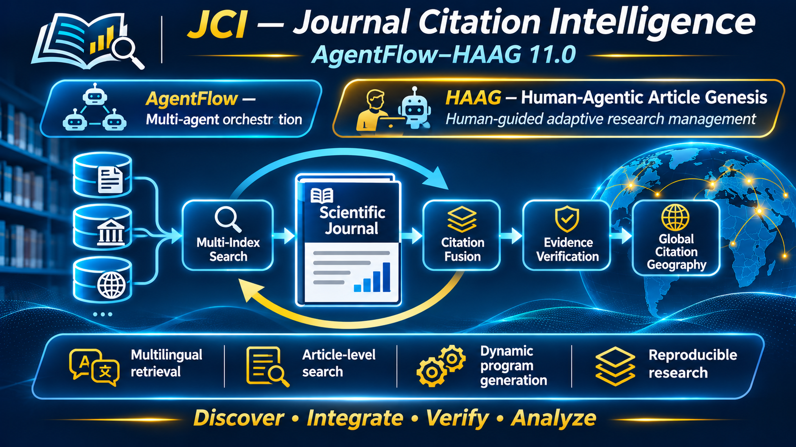

# JCI — Journal Citation Intelligence

## AgentFlow–HAAG Global Multi-Index Bibliometric Intelligence Framework 11.0

**Adaptive Multi-Agent Framework for Global Journal Citation Discovery, Verification, and Geographical Analysis**

## Overview

Journal Citation Intelligence (JCI) is a universal adaptive multi-agent framework designed to discover, integrate, verify, and analyze bibliographic references to articles published in scientific journals.

The framework addresses the problem of incomplete citation coverage across existing bibliometric databases. Scientific publications may contain references to journal articles that are not represented in conventional citation indexes. This problem is particularly relevant to emerging scientific journals, regional publications, interdisciplinary journals, and journals that are not directly indexed in Scopus or Web of Science.

JCI combines multilingual information retrieval, bibliometric graph analysis, dynamic software generation, multi-agent orchestration, and adaptive research management within a unified methodological environment.

The framework is based on two complementary technologies:

- **AgentFlow** — a no-code framework for the organization and orchestration of interacting intelligent agents using logical primitives.
- **HAAG (Human-Agentic Article Genesis)** — a human-guided adaptive research methodology supporting dynamic research trajectories, task decomposition, agent generation, evidence verification, backtracking, and reproducibility.

Their integration enables the construction of flexible research workflows that adapt to available information sources, computational resources, and emerging research objectives.

## Research Objectives

The primary objective of JCI is to identify the largest possible set of verified citations to articles of a specified scientific journal within a given period.

The framework requires only two principal input parameters:

- `JOURNAL` — the name of the scientific journal.
- `PERIOD` — the citation analysis period.

Journal identifiers, official websites, publication archives, article registries, alternative titles, abbreviations, translations, and bibliographic fingerprints are identified automatically whenever the necessary information is accessible.

The principal analytical result is represented by the relationship:

**COUNTRY → CITING DOCUMENTS → CITATIONS**

The framework determines the total number of verified citations, the number of unique citing publications, the geographical distribution of citations, and the research institutions associated with citing authors.

## Methodological Foundations

JCI integrates seven interconnected methodological components.

### 1. Dynamic Bibliographic Fingerprinting

The framework automatically constructs a comprehensive bibliographic representation of the target journal and its articles.

Bibliographic fingerprints include ISSN identifiers, DOI patterns, official and alternative journal titles, abbreviations, translations, author names, publication years, article titles, and distinctive title fragments.

The dictionary of bibliographic representations is dynamically expanded whenever new variants are discovered during the investigation.

### 2. Exhaustive Multi-Index Search

Citation discovery is organized as a systematic exploration of combinations of information systems, journal title variants, and article-level bibliographic fingerprints.

The framework integrates potentially accessible resources from several information environments:

- Global web indexes: Google, Bing, Brave, and alternative search engines.
- Bibliometric systems and citation graphs: OpenAlex, OUCI, Matilda, Lens, OpenCitations, Semantic Scholar, Scopus, and Web of Science.
- Chinese academic resources: AMiner, CNKI, Baidu Scholar, Wanfang, and BookSci.
- Subject-specific indexes: Inspec, Compendex, DBLP, and zbMATH.
- National and regional academic information systems.
- International scientific publishers and institutional repositories.
- Open bibliographic datasets, including OpenAIRE, S2ORC, and Crossref.

The investigation uses available and applicable resources rather than assuming unrestricted access to every listed information system.

### 3. Bidirectional Citation Discovery

Two complementary retrieval strategies are employed.

**Forward article-level retrieval** begins with articles of the target journal and searches for publications containing references to these articles.

**Reverse geographical and thematic retrieval** begins with potentially relevant publications, research institutions, countries, and thematic document collections. Their reference lists are subsequently analyzed to identify citations to articles of the target journal.

The combination of these strategies reduces dependence on conventional citation graphs and supports the discovery of references represented by incomplete or non-standard bibliographic metadata.

### 4. Adaptive Multi-Agent Architecture

The framework employs interacting groups of research agents responsible for:

- Research orchestration.
- Bibliographic identification.
- Multilingual information retrieval.
- Regional and national database exploration.
- Dynamic software generation.
- Citation verification.
- Bibliographic data integration.
- Geographical analysis.
- Independent auditing and synthesis.

AgentFlow provides the mechanisms for agent coordination, while HAAG manages the evolving research trajectory.

Additional agents and research branches may be generated dynamically to investigate unresolved bibliographic records, geographical gaps, and newly discovered information resources.

### 5. Dynamic Program Generation

JCI supports the dynamic generation of computational modules required for particular research tasks.

The general computational cycle is:

**GENERATE → TEST → EXECUTE → VERIFY → INTEGRATE**

When errors occur, program modules may be repaired, retested, or replaced.

Dynamically generated modules may perform API communication, bibliographic retrieval, document parsing, reference extraction, metadata normalization, deduplication, citation graph traversal, statistical analysis, geographical visualization, and data export.

This mechanism allows the computational capabilities of the framework to evolve during the investigation rather than remain restricted to predefined software instruments.

### 6. Multi-Index Citation Fusion

Multi-Index Citation Fusion (MICF) is the central data integration mechanism of the framework.

Bibliographic records obtained from heterogeneous information systems are normalized, compared, deduplicated, and verified.

The resulting unified citation graph preserves individual citation relationships together with their supporting evidence and information provenance.

A citation discovered in several information systems is counted only once.

Candidate references that cannot be sufficiently verified are preserved separately and excluded from the principal citation statistics.

### 7. Geographical Citation Analysis and Independent Audit

The geographical distribution of citations is determined from the institutional affiliations of citing authors rather than their nationality, publication language, publisher location, or website domain.

The framework supports both full and fractional geographical counting.

Full counting assigns citations to every country represented in the verified affiliations of a citing publication. Fractional counting distributes citations among these countries to avoid multiple geographical attribution.

Independent HAAG auditing verifies bibliographic evidence, publication dates, institutional affiliations, duplicate elimination, numerical consistency, and actual retrieval coverage.

Every principal numerical indicator must be reproducible from the individual bibliographic records.

## Research Workflow

The framework defines twenty principal research stages covering journal identification, instrumental capability discovery, article inventory, multilingual retrieval, citation graph traversal, regional exploration, publisher and repository analysis, reverse retrieval, citation fusion, geographical verification, and independent auditing.

These stages constitute an adaptive research trajectory rather than a rigid sequence of operations.

The research methodology supports:

**FORK · SPAWN · MERGE · BACKTRACK · VERIFY · AUDIT**

Research resources may be dynamically redistributed toward productive information sources, insufficiently investigated regions, and unresolved bibliographic records.

The inclusion and verification criteria remain independent of the desired numerical results.

## Research Outputs

Depending on available computational capabilities, the framework generates:

- Verified citation statistics.
- Country-level citation distributions.
- Global citation maps.
- Registries of citing publications and cited articles.
- Research institution distributions.
- Unified citation graphs.
- Information source performance indicators.
- Retrieval coverage matrices.
- Bibliographic evidence registries.
- Independent audit reports.
- Reproducible research checkpoints.

Supported output formats may include CSV, JSON, XLSX, DOCX, PNG, SVG, and GEXF.

## Scientific Contribution

The principal methodological contribution of JCI is the integration of systematic multi-index citation discovery with adaptive multi-agent research management, dynamic program generation, and evidence-based bibliometric verification.

Unlike approaches restricted to a single bibliometric database, JCI treats citation analysis as a distributed information discovery problem involving heterogeneous, multilingual, and geographically dispersed information resources.

The combination of bibliographic fingerprinting, bidirectional retrieval, Multi-Index Citation Fusion, and independent auditing provides a methodological foundation for extending the observable citation coverage of scientific journals.

The effectiveness and incremental contribution of the framework should be evaluated through reproducible comparative experiments.

## Applications

Potential applications include:

- Assessment of the international visibility of scientific journals.
- Citation analysis of journals not indexed in major bibliometric databases.
- Geographical analysis of scientific information flows.
- Evaluation of emerging and regional scientific publications.
- Scientific journal development strategies.
- Institutional research analytics.
- Interdisciplinary citation discovery.
- Integration with scientific information systems and OSINT platforms.

## Transparency and Reproducibility

JCI follows the principle that no bibliometric indicator should be reported without sufficient supporting evidence.

The framework distinguishes verified citations from candidate records, accessible information systems from unavailable resources, and completed search operations from planned procedures.

It does not assume that multi-index retrieval guarantees complete global citation coverage.

The objective is to maximize documented citation discovery while maintaining methodological transparency, numerical consistency, and research reproducibility.

---

**JCI — Journal Citation Intelligence**

*Powered by AgentFlow and HAAG*

**Discover · Integrate · Verify · Analyze**
